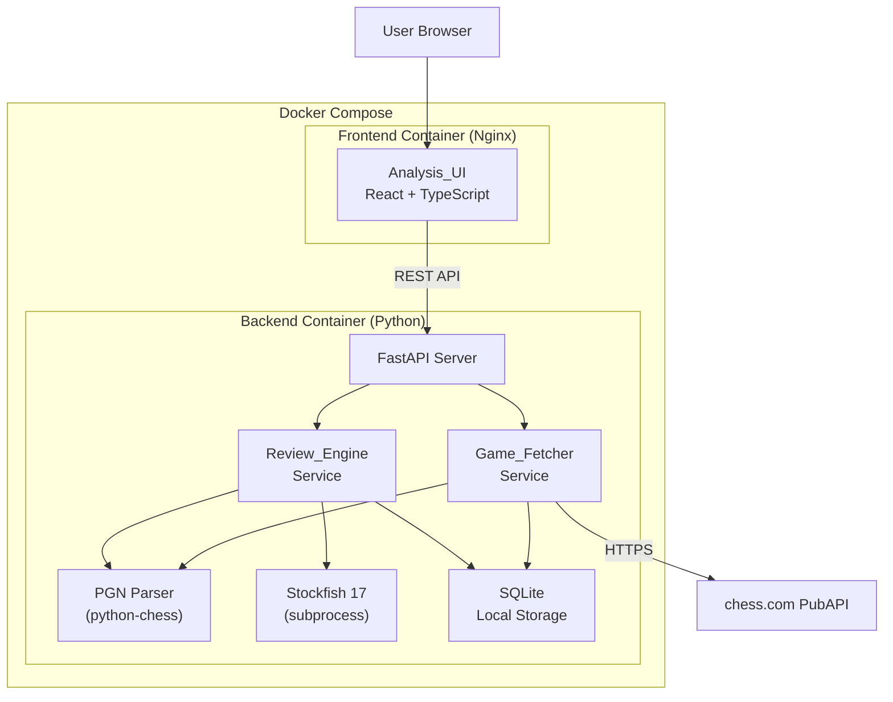
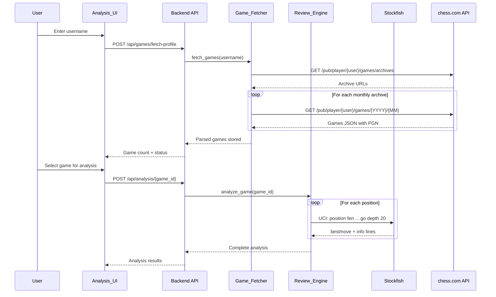

# Design Document

## Overview

The Chess Review Engine is a containerized, locally-deployed web application that fetches chess games from chess.com and analyzes them with the Stockfish engine. The system consists of three main services — a React frontend (Analysis_UI), a Python/FastAPI backend (Review_Engine + Game_Fetcher), and a Stockfish process — all orchestrated via Docker Compose.

**Technology Stack:**
- **Frontend**: React 18 with TypeScript, using `react-chessboard` for board rendering, `chess.js` for client-side move logic, and Recharts for evaluation/performance graphs.
- **Backend**: Python 3.12 with FastAPI, using the `python-chess` library for PGN parsing, FEN generation, and Stockfish UCI communication.
- **Engine**: Stockfish 17 binary running inside the backend container, communicated with via the UCI protocol through `python-chess`.
- **Deployment**: Docker Compose with two containers — one for the frontend (Nginx serving static React build) and one for the backend (FastAPI + Stockfish).

**Key Design Decisions:**
1. **Python backend with `python-chess`**: This library provides both PGN parsing and Stockfish UCI integration in a single, well-maintained package. This avoids separate dependencies for parsing and engine communication and is the de facto standard for chess programming in Python.
2. **Stockfish co-located with backend**: Rather than running Stockfish as a separate container, it runs as a subprocess within the backend container. This eliminates network overhead for the thousands of UCI commands per game analysis and simplifies deployment.
3. **React with `react-chessboard`**: The most actively maintained React chess board component, providing FEN-based rendering with SVG pieces, square highlighting, and responsive layout out of the box.
4. **Chess.com PubAPI direct integration**: The chess.com Published-Data API is a free, read-only REST API requiring no authentication. Games are fetched via monthly archive endpoints (`/pub/player/{username}/games/archives` → `/pub/player/{username}/games/{YYYY}/{MM}`), with each response including PGN data.

## Architecture

The system follows a client-server architecture with a clear separation between the UI layer (frontend), the application logic layer (backend API), and the engine layer (Stockfish subprocess).



**Data Flow:**

1. **Game Fetching**: User submits username/URL → Frontend calls Backend API → Game_Fetcher calls chess.com PubAPI → PGN responses are parsed by `python-chess` → Structured game data is stored in SQLite.
2. **Game Analysis**: User selects a game → Frontend calls Backend analysis endpoint → Review_Engine sends positions to Stockfish via UCI → Evaluations, classifications, and insights are computed and stored → Results returned to frontend.
3. **Game Browsing**: User navigates moves → Frontend requests position data from backend → Backend serves pre-computed analysis results → Frontend renders board, evaluation bar, graphs, and insights.



## Components and Interfaces

### Frontend Components

#### AnalysisUI (React Application)

The top-level React application with route-based navigation.

| Component | Responsibility | Props/State |
|-----------|---------------|-------------|
| `App` | Route management, global state | Current user profile, fetched games |
| `ProfileInput` | Username/URL input with validation | `onSubmit(username\|url)`, loading state |
| `GameList` | Scrollable, sortable game list | `games[]`, `sortField`, `sortOrder` |
| `GameListItem` | Single game row display | `game: GameSummary` |
| `AnalysisView` | Main analysis layout container | `gameId`, `analysis` |
| `ChessBoard` | Interactive board with `react-chessboard` | `fen`, `arrows`, `squareStyles` |
| `MoveNavigator` | Forward/back/first/last controls | `currentMove`, `totalMoves`, `onNavigate` |
| `EvaluationBar` | Vertical eval bar (white/black advantage) | `evaluation: number \| MateIn` |
| `EvaluationGraph` | Line chart of centipawn evals | `evaluations[]`, `currentMove`, `onClick` |
| `PerformanceGraph` | Line chart of mid-game ratings | `ratings: {white[], black[]}`, `currentMove` |
| `MoveList` | Tabular move list with classifications | `moves[]`, `currentMove`, `onSelect` |
| `CandidateMoves` | Top-3 Stockfish suggestions | `candidates[]`, `playerMove` |
| `InsightPanel` | Explanation for suboptimal moves | `insight: LearningInsight \| null` |
| `GameSummary` | Classification counts + final ratings | `summary: GameAnalysisSummary` |
| `ProgressIndicator` | Fetch/analysis progress display | `progress: number`, `type: 'fetch'\|'analysis'` |

#### Frontend API Client

```typescript
interface ChessReviewAPI {
  // Game Fetching
  fetchProfile(username: string): Promise<FetchResult>;
  fetchGameByUrl(url: string): Promise<FetchResult>;
  getGames(sortBy?: SortField, order?: SortOrder): Promise<GameSummary[]>;

  // Analysis
  startAnalysis(gameId: string): Promise<void>;
  getAnalysisStatus(gameId: string): Promise<AnalysisStatus>;
  getAnalysis(gameId: string): Promise<GameAnalysis>;

  // Server-Sent Events for progress
  streamFetchProgress(username: string): EventSource;
  streamAnalysisProgress(gameId: string): EventSource;
}
```

### Backend Components

#### API Layer (FastAPI)

| Endpoint | Method | Description |
|----------|--------|-------------|
| `/api/games/fetch-profile` | POST | Fetch all games for a chess.com username |
| `/api/games/fetch-url` | POST | Fetch a single game by chess.com URL |
| `/api/games` | GET | List fetched games with sorting |
| `/api/games/{game_id}` | GET | Get single game details |
| `/api/analysis/{game_id}` | POST | Start Stockfish analysis for a game |
| `/api/analysis/{game_id}` | GET | Get analysis results |
| `/api/analysis/{game_id}/status` | GET | Get analysis progress |
| `/api/stream/fetch/{username}` | GET | SSE stream for fetch progress |
| `/api/stream/analysis/{game_id}` | GET | SSE stream for analysis progress |

#### Game_Fetcher Service

```python
class GameFetcher:
    """Fetches and parses games from chess.com PubAPI."""

    async def fetch_profile_games(self, username: str) -> FetchResult:
        """Fetch all games for a username, up to 10,000 most recent."""
        ...

    async def fetch_game_by_url(self, url: str) -> FetchResult:
        """Fetch a single game by chess.com game URL."""
        ...

    def validate_username(self, username: str) -> ValidationResult:
        """Validate username format (non-empty, max 25 chars)."""
        ...

    def validate_game_url(self, url: str) -> ValidationResult:
        """Validate chess.com game URL format."""
        ...

    def parse_pgn(self, pgn_string: str) -> ParsedGame:
        """Parse PGN string into structured game representation."""
        ...

    def format_pgn(self, game: ParsedGame) -> str:
        """Format structured game back into PGN string."""
        ...
```

#### Review_Engine Service

```python
class ReviewEngine:
    """Analyzes chess positions using Stockfish."""

    def __init__(self, stockfish_path: str, depth: int = 20):
        ...

    async def analyze_game(self, game_id: str) -> GameAnalysis:
        """Run full analysis on a stored game."""
        ...

    def evaluate_position(self, fen: str, multi_pv: int = 3) -> PositionEvaluation:
        """Evaluate a single position with Stockfish."""
        ...

    def classify_move(
        self, player_eval: int, best_eval: int
    ) -> MoveClassification:
        """Classify a move based on centipawn loss thresholds."""
        ...

    def compute_performance_rating(
        self, centipawn_losses: list[int]
    ) -> int:
        """Compute cumulative performance rating from centipawn losses."""
        ...

    def generate_insight(
        self, move_number: int, played_move: str,
        best_move: str, centipawn_loss: int,
        principal_variation: list[str],
        classification: MoveClassification
    ) -> LearningInsight:
        """Generate learning insight for a suboptimal move."""
        ...
```

#### PGN Parser (via python-chess)

The PGN parser wraps `python-chess`'s `chess.pgn` module, providing:
- Parsing PGN strings to structured `ParsedGame` objects
- Extracting the Seven Tag Roster and additional headers
- Iterating through the move list with FEN positions at each half-move
- Formatting structured games back to PGN export format
- Preserving comment annotations through round-trips

#### Stockfish UCI Interface (via python-chess)

Communication with Stockfish uses `python-chess`'s `chess.engine` module:
- Spawns Stockfish as a subprocess via `chess.engine.SimpleEngine.popen_uci()`
- Sends `position fen <fen>` and `go depth 20` commands
- Retrieves evaluations (centipawn score or mate-in-N) and top-N candidate moves via MultiPV
- Engine lifecycle managed by the Review_Engine service (single instance, reused across analyses)

## Data Models

### Core Domain Models

```python
from dataclasses import dataclass, field
from enum import Enum
from datetime import datetime

class MoveClassification(Enum):
    BEST = "best"           # cp_loss == 0
    EXCELLENT = "excellent"  # 1 <= cp_loss <= 10
    GOOD = "good"           # 11 <= cp_loss <= 30
    INACCURACY = "inaccuracy"  # 31 <= cp_loss <= 80
    MISTAKE = "mistake"     # 81 <= cp_loss <= 200
    BLUNDER = "blunder"     # cp_loss >= 201

class GameResult(Enum):
    WIN = "win"
    LOSS = "loss"
    DRAW = "draw"

@dataclass
class ParsedGame:
    """Structured representation of a chess game parsed from PGN."""
    # Seven Tag Roster (required PGN headers)
    event: str
    site: str
    date: str
    round: str
    white: str
    black: str
    result: str
    # Additional headers
    additional_headers: dict[str, str] = field(default_factory=dict)
    # Move data
    moves: list[str] = field(default_factory=list)  # SAN notation
    comments: list[str | None] = field(default_factory=list)  # Per-move comments
    fens: list[str] = field(default_factory=list)    # FEN after each half-move

@dataclass
class GameSummary:
    """Summary info for game list display."""
    game_id: str
    date_played: datetime
    opponent: str
    result: GameResult
    time_control: str | None
    opening_name: str | None
    is_analyzed: bool

@dataclass
class PositionEvaluation:
    """Stockfish evaluation of a single position."""
    fen: str
    evaluation: int | None       # Centipawns from White's perspective
    mate_in: int | None          # Mate-in-N (positive=White, negative=Black)
    candidate_moves: list["CandidateMove"]  # Up to 3
    is_error: bool = False

@dataclass
class CandidateMove:
    """A candidate move suggested by Stockfish."""
    move_san: str
    evaluation: int | None       # Centipawns
    mate_in: int | None

@dataclass
class AnalyzedMove:
    """A single analyzed half-move in the game."""
    move_number: int
    is_white: bool
    move_san: str
    position_before: str          # FEN
    position_after: str           # FEN
    evaluation_before: PositionEvaluation
    evaluation_after: PositionEvaluation
    classification: MoveClassification | None
    centipawn_loss: int | None
    candidate_moves: list[CandidateMove]
    insight: "LearningInsight | None"

@dataclass
class LearningInsight:
    """Explanation for a suboptimal move."""
    move_number: int
    is_white: bool
    played_move: str
    best_move: str
    centipawn_loss: int
    classification: MoveClassification
    principal_variation: list[str]  # Up to 5 moves
    explanation: str

@dataclass
class GameAnalysis:
    """Complete analysis results for a game."""
    game_id: str
    moves: list[AnalyzedMove]
    white_summary: PlayerAnalysisSummary
    black_summary: PlayerAnalysisSummary
    evaluations: list[int | None]     # Centipawn per half-move for graph
    is_complete: bool

@dataclass
class PlayerAnalysisSummary:
    """Per-player summary of analysis results."""
    best_count: int
    excellent_count: int
    good_count: int
    inaccuracy_count: int
    mistake_count: int
    blunder_count: int
    performance_ratings: list[int]    # Cumulative after each of player's moves
    final_performance_rating: int

@dataclass
class AnalysisStatus:
    """Progress of an ongoing analysis."""
    game_id: str
    total_positions: int
    positions_analyzed: int
    is_complete: bool

    @property
    def percentage(self) -> int:
        if self.total_positions == 0:
            return 0
        return int((self.positions_analyzed / self.total_positions) * 100)
```

### Database Schema (SQLite)

```sql
CREATE TABLE games (
    id TEXT PRIMARY KEY,
    username TEXT NOT NULL,
    pgn_raw TEXT NOT NULL,
    event TEXT,
    site TEXT,
    date_played TEXT,
    round TEXT,
    white TEXT NOT NULL,
    black TEXT NOT NULL,
    result TEXT NOT NULL,
    time_control TEXT,
    opening_name TEXT,
    additional_headers TEXT,  -- JSON
    moves TEXT NOT NULL,       -- JSON array of SAN strings
    comments TEXT,             -- JSON array
    fens TEXT NOT NULL,        -- JSON array of FEN strings
    fetched_at TIMESTAMP DEFAULT CURRENT_TIMESTAMP
);

CREATE TABLE analysis_results (
    id TEXT PRIMARY KEY,
    game_id TEXT NOT NULL REFERENCES games(id),
    move_index INTEGER NOT NULL,
    is_white BOOLEAN NOT NULL,
    move_san TEXT NOT NULL,
    fen_before TEXT NOT NULL,
    fen_after TEXT NOT NULL,
    eval_before INTEGER,        -- centipawns or NULL
    mate_before INTEGER,        -- mate-in-N or NULL
    eval_after INTEGER,
    mate_after INTEGER,
    classification TEXT,        -- MoveClassification value
    centipawn_loss INTEGER,
    candidate_moves TEXT,       -- JSON array
    insight TEXT,               -- JSON object or NULL
    UNIQUE(game_id, move_index)
);

CREATE TABLE analysis_summaries (
    game_id TEXT PRIMARY KEY REFERENCES games(id),
    is_complete BOOLEAN NOT NULL DEFAULT FALSE,
    white_best INTEGER DEFAULT 0,
    white_excellent INTEGER DEFAULT 0,
    white_good INTEGER DEFAULT 0,
    white_inaccuracy INTEGER DEFAULT 0,
    white_mistake INTEGER DEFAULT 0,
    white_blunder INTEGER DEFAULT 0,
    white_performance_ratings TEXT,  -- JSON array
    white_final_rating INTEGER,
    black_best INTEGER DEFAULT 0,
    black_excellent INTEGER DEFAULT 0,
    black_good INTEGER DEFAULT 0,
    black_inaccuracy INTEGER DEFAULT 0,
    black_mistake INTEGER DEFAULT 0,
    black_blunder INTEGER DEFAULT 0,
    black_performance_ratings TEXT,  -- JSON array
    black_final_rating INTEGER
);

CREATE INDEX idx_games_username ON games(username);
CREATE INDEX idx_games_date ON games(date_played);
CREATE INDEX idx_analysis_game ON analysis_results(game_id);
```


## Correctness Properties

*A property is a characteristic or behavior that should hold true across all valid executions of a system — essentially, a formal statement about what the system should do. Properties serve as the bridge between human-readable specifications and machine-verifiable correctness guarantees.*

### Property 1: PGN Round-Trip Fidelity

*For any* valid PGN string, parsing it into a structured game representation, formatting that representation back into a PGN string, and re-parsing the result SHALL produce a structured representation with the same move sequence (in standard algebraic notation), the same Seven Tag Roster header values, the same additional tag pair values, and the same comment annotations as the original parse.

**Validates: Requirements 4.1, 4.2, 4.3**

### Property 2: Malformed PGN Error Reporting

*For any* string that is not a valid PGN (containing invalid move notation, missing required headers, or structural errors), the PGN parser SHALL return an error rather than a successful parse, and that error SHALL identify the location (move number or header name) where parsing failed.

**Validates: Requirements 4.4**

### Property 3: Move Classification Threshold Correctness

*For any* non-negative integer centipawn loss value, the `classify_move` function SHALL assign exactly one classification according to the defined thresholds: best move for 0, excellent for 1–10, good for 11–30, inaccuracy for 31–80, mistake for 81–200, and blunder for 201 or greater. No centipawn loss value SHALL map to zero or more than one classification.

**Validates: Requirements 6.1, 6.2**

### Property 4: Classification Summary Aggregation

*For any* list of analyzed moves with assigned classifications for two players, the per-player classification counts in the game summary SHALL equal the actual count of each classification category in the move list for that player.

**Validates: Requirements 6.4**

### Property 5: Username Validation Rejects Invalid Input

*For any* string that is either empty or exceeds 25 characters in length, the username validator SHALL reject it and return an invalid-format error. *For any* non-empty string of 25 characters or fewer, the username validator SHALL accept the format as valid.

**Validates: Requirements 1.6**

### Property 6: URL Validation Rejects Invalid Format

*For any* string that does not match the recognized chess.com game URL pattern, the URL validator SHALL reject it and return an error indicating the URL is not a valid chess.com game URL.

**Validates: Requirements 2.3**

### Property 7: Game List Sort Correctness

*For any* list of game summaries and any valid sort configuration (sort field being date, result, or time control; sort order being ascending or descending), the sorted output list SHALL contain exactly the same games as the input list and each consecutive pair of elements SHALL satisfy the specified ordering.

**Validates: Requirements 3.1, 3.4**

### Property 8: Game List Item Completeness

*For any* game summary object, the rendered game list item SHALL include the value of every present metadata field (date played, opponent username, game result, time control, opening name) and SHALL display an "unavailable" placeholder for each metadata field that is missing or null.

**Validates: Requirements 3.2, 3.6**

### Property 9: Candidate Moves Display Correctness

*For any* position with N legal moves where N ≥ 1, the candidate moves display SHALL show min(N, 3) candidate moves sorted in descending order of centipawn evaluation, SHALL display the centipawn evaluation for each candidate and for the player's actual move, and SHALL visually mark the player's move within the candidate list if the player's move is among the displayed candidates.

**Validates: Requirements 7.1, 7.3, 7.4**

### Property 10: Performance Rating Range Invariant

*For any* non-empty sequence of non-negative centipawn loss values, the computed cumulative performance rating after each move SHALL be a whole integer in the range [0, 3000] inclusive.

**Validates: Requirements 8.1**

### Property 11: Learning Insight Completeness

*For any* move classified as inaccuracy, mistake, or blunder, the generated learning insight SHALL contain the centipawn loss between the played move and the best move, the suggested best move in standard algebraic notation, and a principal variation line of at most 5 moves.

**Validates: Requirements 9.1, 9.2**

### Property 12: Learning Summary Includes All Suboptimal Moves

*For any* completed game analysis, the learning summary SHALL list every move classified as inaccuracy, mistake, or blunder — and no moves classified as best, excellent, or good — along with each listed move's explanation.

**Validates: Requirements 9.4**

### Property 13: Evaluation Graph Clamping

*For any* centipawn evaluation value, the evaluation graph SHALL display it clamped to the range [−2000, +2000]. *For any* mate-in-N evaluation, the graph SHALL represent it at the ±2000 boundary (positive for White mate, negative for Black mate).

**Validates: Requirements 11.1**

### Property 14: Critical Moment Detection

*For any* sequence of centipawn evaluations for consecutive moves, the evaluation graph SHALL display a distinct marker at position i if and only if the absolute difference between the evaluation at position i and the evaluation at position i−1 exceeds 100 centipawns.

**Validates: Requirements 11.3**

### Property 15: Evaluation Graph Gap Handling

*For any* sequence of position evaluations where one or more positions have unavailable evaluation data, the evaluation graph SHALL omit the unavailable positions and connect the nearest positions that have evaluation data, preserving the correct move-number mapping on the X-axis for all included points.

**Validates: Requirements 11.5**

## Error Handling

### API Layer Errors

| Error Condition | HTTP Status | Response |
|----------------|-------------|----------|
| Username empty or > 25 chars | 400 | `{ "error": "invalid_username", "message": "Username must be 1-25 characters" }` |
| Invalid chess.com game URL format | 400 | `{ "error": "invalid_url", "message": "Not a valid chess.com game URL" }` |
| chess.com API timeout (> 30s) | 504 | `{ "error": "upstream_timeout", "message": "Connection to chess.com failed" }` |
| chess.com API unreachable | 502 | `{ "error": "upstream_unreachable", "message": "Connection to chess.com failed" }` |
| Username not found on chess.com | 404 | `{ "error": "username_not_found", "message": "Username was not found on chess.com" }` |
| Game not found on chess.com | 404 | `{ "error": "game_not_found", "message": "Game was not found on chess.com" }` |
| No games for username | 200 | `{ "games": [], "count": 0, "message": "No games found for this username" }` |
| PGN parsing failure | 422 | `{ "error": "pgn_parse_error", "message": "Parsing failed at move {N}: {reason}" }` |
| Game not yet analyzed | 404 | `{ "error": "analysis_not_found", "message": "Analysis not available. Run analysis first." }` |
| Analysis already in progress | 409 | `{ "error": "analysis_in_progress", "message": "Analysis is already running for this game" }` |

### Backend Error Strategy

- **chess.com API errors**: The Game_Fetcher wraps all chess.com API calls with a 30-second timeout per request using `httpx.AsyncClient(timeout=30.0)`. HTTP 404 from chess.com maps to username/game not found. Network errors and timeouts map to connection-failed errors. Responses are validated before parsing.
- **PGN parsing errors**: The `python-chess` PGN parser raises exceptions on malformed input. These are caught and transformed into structured error responses identifying the failure location (move number or header name).
- **Stockfish errors**: If Stockfish returns an invalid evaluation or crashes during analysis, the Review_Engine marks the affected position as an error in the results and continues to the next position (Requirement 5.7). The Stockfish subprocess is monitored and restarted if it terminates unexpectedly.
- **Database errors**: SQLite operations are wrapped in transactions. Write failures are retried once, then surfaced as 500 errors.

### Frontend Error Strategy

- **Network errors**: All API calls use a shared HTTP client with error interceptors. Timeout and network errors show a toast notification with the error message.
- **Progress interruption**: If an SSE connection drops during fetch or analysis progress, the frontend reconnects automatically with exponential backoff (1s, 2s, 4s, max 30s) and resumes from the last known progress.
- **Stale state**: When analysis status shows complete, the frontend fetches full results in a single request, ensuring atomic display transition from progress to results (Requirement 5.6).

## Testing Strategy

### Unit Tests

Unit tests target pure functions and isolated logic using **pytest** (backend) and **Vitest** (frontend):

- **PGN parser**: Specific PGN examples (standard games, games with comments, games with variations), edge cases (empty moves, missing headers, Seven Tag Roster completeness)
- **Move classifier**: Boundary values at each threshold (0, 1, 10, 11, 30, 31, 80, 81, 200, 201), and classification-to-visual-mapping uniqueness
- **Performance rating**: Known centipawn-loss sequences with expected ratings, boundary values (all-perfect and all-blunder games)
- **Evaluation clamping**: Specific values at and beyond ±2000, mate-in-N cases
- **Insight generation**: Example suboptimal moves with known best moves and PVs
- **Username/URL validators**: Specific valid and invalid inputs (edge cases: exactly 25 chars, exactly 26 chars, empty string, various URL formats)
- **Game list sorting**: Specific lists with known sort orders
- **Frontend components**: React component rendering with React Testing Library, verifying correct props propagation, conditional rendering, and accessibility

### Property-Based Tests

Property-based tests use **Hypothesis** (Python backend) and **fast-check** (TypeScript frontend), each configured for a minimum of 100 iterations per property. Each test references its design document property.

**Backend properties (Hypothesis):**
- **Property 1**: PGN round-trip — generate random valid PGN games using custom Hypothesis strategies for move sequences, headers, and comments. Tag: `Feature: chess-review-engine, Property 1: PGN round-trip fidelity`
- **Property 2**: Malformed PGN error — generate random invalid PGN strings (corrupt move notation, missing headers, truncated data). Tag: `Feature: chess-review-engine, Property 2: Malformed PGN error reporting`
- **Property 3**: Move classification thresholds — generate random non-negative integers as centipawn loss. Tag: `Feature: chess-review-engine, Property 3: Move classification threshold correctness`
- **Property 4**: Classification summary — generate random lists of AnalyzedMove with random classifications per player. Tag: `Feature: chess-review-engine, Property 4: Classification summary aggregation`
- **Property 5**: Username validation — generate random strings of varying lengths. Tag: `Feature: chess-review-engine, Property 5: Username validation rejects invalid input`
- **Property 6**: URL validation — generate random strings and valid-but-wrong URL formats. Tag: `Feature: chess-review-engine, Property 6: URL validation rejects invalid format`
- **Property 10**: Performance rating range — generate random sequences of centipawn losses (0-500 range). Tag: `Feature: chess-review-engine, Property 10: Performance rating range invariant`
- **Property 11**: Insight completeness — generate random suboptimal moves with classification, centipawn loss, best move, and PV. Tag: `Feature: chess-review-engine, Property 11: Learning insight completeness`
- **Property 12**: Learning summary — generate random analysis results with mixed classifications. Tag: `Feature: chess-review-engine, Property 12: Learning summary includes all suboptimal moves`
- **Property 13**: Evaluation clamping — generate random integers and mate-in-N values. Tag: `Feature: chess-review-engine, Property 13: Evaluation graph clamping`
- **Property 14**: Critical moment markers — generate random evaluation sequences. Tag: `Feature: chess-review-engine, Property 14: Critical moment detection`
- **Property 15**: Evaluation gap handling — generate random evaluation sequences with None gaps. Tag: `Feature: chess-review-engine, Property 15: Evaluation graph gap handling`

**Frontend properties (fast-check):**
- **Property 7**: Game list sorting — generate random game summary arrays, apply each sort field and order. Tag: `Feature: chess-review-engine, Property 7: Game list sort correctness`
- **Property 8**: Game list item completeness — generate random GameSummary objects with optional null fields. Tag: `Feature: chess-review-engine, Property 8: Game list item completeness`
- **Property 9**: Candidate moves display — generate random candidate move arrays with evaluations. Tag: `Feature: chess-review-engine, Property 9: Candidate moves display correctness`

### Integration Tests

Integration tests verify component interactions and external service behavior:

- **chess.com API integration**: Fetch games for a known test username, verify PGN data is returned and parseable (1-2 examples)
- **Stockfish analysis pipeline**: Analyze a short game (5-10 moves), verify evaluations at depth ≥ 20, candidate moves, and mate detection
- **End-to-end fetch → analysis flow**: Fetch a real game, run analysis, verify complete results chain
- **Error scenarios**: Mock chess.com returning 404, timeout, empty game list — verify correct error messages
- **Database persistence**: Verify games and analysis results survive service restart

### Smoke Tests

- **Docker Compose startup**: Verify `docker compose up` starts all services and UI is accessible within 120 seconds
- **Docker Compose teardown**: Verify `docker compose down` removes all containers and networks
- **Port configuration**: Verify UI port defaults to 3000 and is configurable via environment variable
